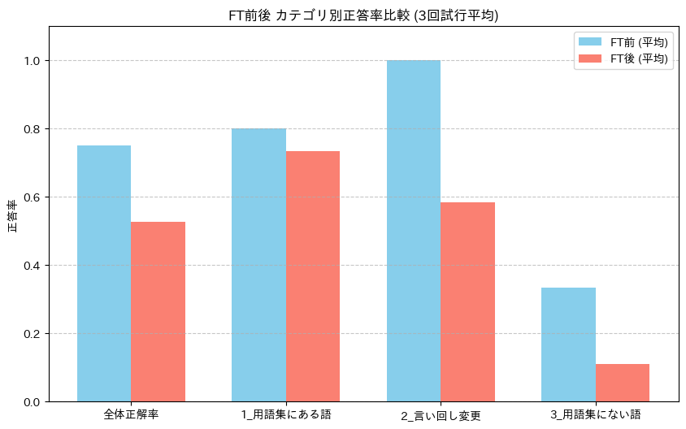
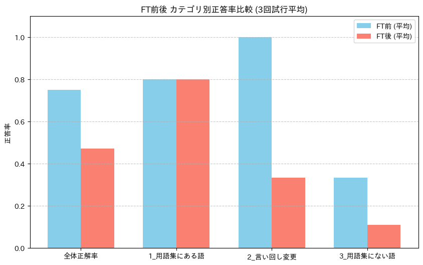

# 第2回 解答

## 演習

- 使ったモデル・設定（`result.json` の `config` から）：Qwen/Qwen3.5-0.8B
- 自分で学習を実行したか（`executed_training_myself`）：はい
- 学習前：`format_rate` =　0.095238 / `content_rate` =　0.000000
- 学習後：`format_rate` =　1.000000 / `content_rate` =　0.857143
- 退行した質問：なし
- 学習後に残った失敗と、その型（根拠なしの質問に断定した / 根拠ありの質問に確認要求で逃げた / 形式の崩れ）：根拠なしの質問に断定した（3つ失敗していずれもこれ）
- 知識を問う質問（セクション 6）の結果（学習前の分類 → 学習後の分類）と気づいたこと：学習前は全て`format_error`となっていたが，学習後には適切な分類を成されていたように見える．特に架空の質問「個の講座の最終課題の締め切りはいつですか」については，assertedと分類しており，deadlineの内容を用いて解凍していた．FAQにある対照用の質問「課題の提出期限はいつですか」が示す課題と最終課題が同じである場合は，これは適切な分類になると思う．
- 学習で変わったこと・変わらなかったこと：学習前後の`format_rate`と`content_rate`を見ても分かるが，変わった面としては精度が格段に向上している点が挙げられる．特に肩に関しては，私の環境において全てのケースでneeds_reviewの項目を欠いていたが，学習後には全て適切な型となっていた．加えて，回答内容も学習前はFAQの文章を基に独自の文章を生成する蹴項が見えたが，学習後は元の文章を用いた回答が確認された．

## 宿題

- 取り組んだレベル：発展
- 変えた設定やデータ： 

システムプロンプトを以下の形式に変更．glossary_strの情報はリポジトリにある単語集`glossary.json`を用いて`term`と`definition`から作成．

```python
f"""あなたはAIエンジニアリング講座の用語集アシスタントです。
以下の【用語集データ】に基づいて、ユーザーから尋ねられた用語の意味や説明を回答してください。

【重要なルール】
・ユーザーが尋ねた単語が以下の【用語集データ】のキー（用語）に存在しない場合は、自身の知識や推測で答えず、必ず「記載がありません」とだけ答えてください。
・回答は【用語集データ】の内容に忠実に行ってください。

【用語集データ】
{glossary_str}
"""
```

テストデータを以下のように作成

```python
train_ds = Dataset.from_list(glossary_data)
valid_ds = Dataset.from_list(glossary_data[:10])  # エラー回避用に先頭10件だけ入れておく
print(f"学習データ件数: {len(train_ds)} 件")

# 2. 学習前・学習後で共通して使う「評価用の質問と正解キーワード」
TEST_CASES = [
    # --- 1. 用語集にある語（学習データと同じ聞き方） ---
    {"question": "「AIエンジニアリング」とは何ですか？", "category": "1_用語集にある語", "must_include": ["基盤モデル", "評価と改善"]},
    {"question": "「既定モデル」とは何ですか？", "category": "1_用語集にある語", "must_include": ["gemini-3.5-flash-lite"]},
    {"question": "「Pi」とは何ですか？", "category": "1_用語集にある語", "must_include": ["コーディングエージェント", "ターミナル"]},
    {"question": "「LoRA」とは何ですか？", "category": "1_用語集にある語", "must_include": ["固定", "低ランク", "PEFT"]},
    {"question": "「answer.md」とは何ですか？", "category": "1_用語集にある語", "must_include": ["結果", "PR"]},

    # --- 2. 言い回しを変えた質問 ---
    {"question": "この講座で標準として使われているLLMのモデル名は何ですか？", "category": "2_言い回し変更", "must_include": ["gemini-3.5-flash-lite"]},
    {"question": "宿題の3レベルには、どのような段階がありますか？", "category": "2_言い回し変更", "must_include": ["基礎", "実装", "発展"]},
    {"question": "Pydantic AIでAPIキーを使わずに動作テストをするには何というモデルを使いますか？", "category": "2_言い回し変更", "must_include": ["TestModel"]},
    {"question": "エージェントの処理の途中に人の確認や承認を組み込むことを何と言いますか？", "category": "2_言い回し変更", "must_include": ["Human-in-the-loop"]},

    # --- 3. 用語集にない語 ---
    {"question": "「RAG（検索拡張生成）」とは何ですか？", "category": "3_用語集にない(実在用語)", "must_include": ["検索", "外部"]},
    {"question": "「AIE-SuperBench」とは何ですか？", "category": "3_用語集にない(架空用語)", "must_include": ["不明", "わかりません", "記載がありません", "存在しません"]},
    {"question": "「最終プレゼン審査会」について簡単に説明してください。", "category": "3_用語集にない(架空用語)", "must_include": ["不明", "わかりません", "記載がありません", "存在しません"]},
]
```

`scripts/make_sft_dataset.py`を実行して得られるjsonlファイルは，各単語に対して２つの事例のみ用意されているので，２パターンの形でtrain/validに分割した．１つ目のパターンは，jsonlファイルの後半10件をvalidに回す形式．これは各単語に対して２件ずつ学習に回せるので，学習フェーズの単語集にある部分だけで見ると演習の形式に近い設定となっている．２パターン目は，各単語１件ずつvalidに回す方法である．これは，trainにおける各単語の事例は少なくなるが，trainとvalid間で持っている単語が共通になる．それぞれのパターンに対して，３回の試行を行った．

- 結果（比較表や数字）：

パターン１


パターン２


- ファインチューニングが向く場面・向かない場面についての考察：演習も踏まえたうえで，今回の結果から考察するに，FTが向くケースは，出力のフォーマットが厳格に決まっていて，それに確実に沿わせたいケースや，学習データが十分に確保できるようなケースという状況で限定気に利用していくのが望ましいと考える．発展課題ではむしろ学習前の方が精度が高いような結果となってしまっているのも踏まえて，単語集を検索するエージェントを実装したほうが，タスクとしても容易なり，単語さえマッチすれば提供する情報は確実になるので，FTするよりも検索エージェントの方が向いていると考えられる．