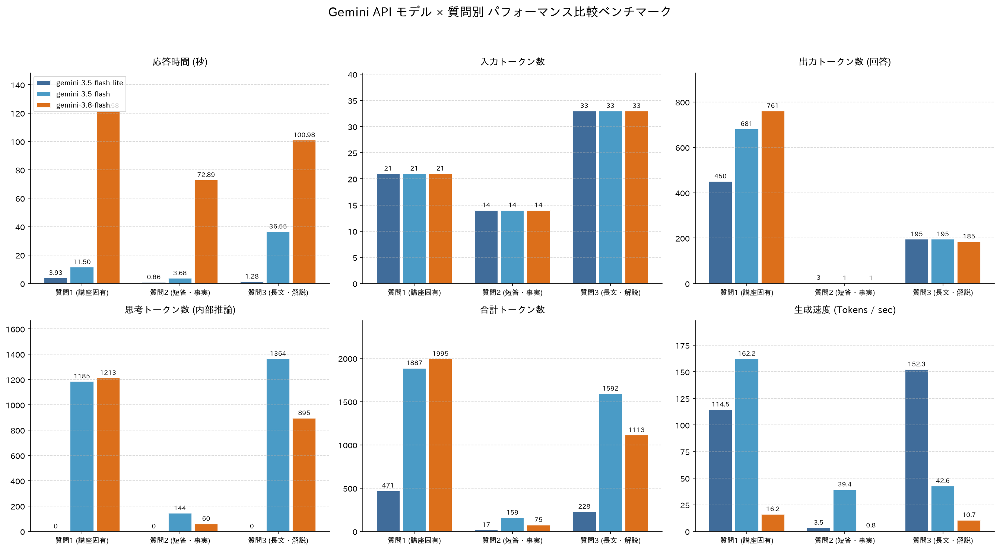

# Gemini API 応答時間・トークン数 比較検証レポート

- **実行日時:** 2026-10-20 03:03:02
- **検証モデル:** `gemini-3.5-flash-lite`, `gemini-3.5-flash`, `gemini-3.8-flash`

---

## 1. 検証に使用した質問セット
- **質問1 (講座固有)**: 「AIE2026の講座の宿題にある「3レベル」とは何ですか？」
- **質問2 (短答・事実)**: 「日本の首都はどこですか？一言で答えてください。」
- **質問3 (長文・解説)**: 「LoRA（Low-Rank Adaptation）の仕組みとメリットを、初学者向けに具体例を交えて300字程度で解説してください。」

---

## 2. 測定結果比較テーブル（モデル × 質問の直積）

| モデル名 | 質問 | 応答時間 (秒) | 入力トークン | 出力トークン | 思考トークン | 合計トークン | 生成速度 (Tok/s) | リトライ回数 |
| :--- | :--- | ---: | ---: | ---: | ---: | ---: | ---: | ---: |
| `gemini-3.5-flash-lite` | 質問1 (講座固有) | 3.93 | 21 | 450 | 0 | 471 | 114.5 | 0 |
| `gemini-3.5-flash-lite` | 質問2 (短答・事実) | 0.86 | 14 | 3 | 0 | 17 | 3.5 | 0 |
| `gemini-3.5-flash-lite` | 質問3 (長文・解説) | 1.28 | 33 | 195 | 0 | 228 | 152.3 | 0 |
| `gemini-3.5-flash` | 質問1 (講座固有) | 11.50 | 21 | 681 | 1185 | 1887 | 162.2 | 0 |
| `gemini-3.5-flash` | 質問2 (短答・事実) | 3.68 | 14 | 1 | 144 | 159 | 39.4 | 0 |
| `gemini-3.5-flash` | 質問3 (長文・解説) | 36.55 | 33 | 195 | 1364 | 1592 | 42.6 | 1 |
| `gemini-3.8-flash` | 質問1 (講座固有) | 121.58 | 21 | 761 | 1213 | 1995 | 16.2 | 0 |
| `gemini-3.8-flash` | 質問2 (短答・事実) | 72.89 | 14 | 1 | 60 | 75 | 0.8 | 0 |
| `gemini-3.8-flash` | 質問3 (長文・解説) | 100.98 | 33 | 185 | 895 | 1113 | 10.7 | 0 |

---

## 3. 評価項目別 比較プロット

---

## 4. 実験結果の分析と無料枠レート制限に関する考察
- **実行件数:** 9（成功 9、エラー 0、リトライ 1）

### (1) モデル別の応答時間と「思考トークン（Thinking Tokens）」の影響
- `thoughts_token_count` は思考**トークン数**であり、思考時間ではない。応答時間はAPIリクエスト開始からレスポンス全体の受信完了までを測定している。
- ストリーミングを使っていないため、最初のトークンが出るまでの時間（TTFT）は今回の測定対象ではない。モデル間の比較は、応答完了時間とトークン数で行う。
- 思考トークンが提供されないレスポンスでは、合計・入力・出力・ツール用トークンの差分を補助的に表示している。

### (2) 質問の性質によるトークン消費の違い（講座固有の質問 vs 一般知識）
- **質問1（講座固有の質問）**: 素のLLMは講座固有のコンテキスト（`data/glossary.json`）を持たないため、「分かりません」と短く切り上げるか、一般的な「3つのレベル」という概念を推測して長文を生成するかでモデルごとに挙動が分かれる。推測で長文を出力してしまうケースでは、ハルシネーションのリスクだけでなく、無駄な出力トークンと応答時間を消費していることが分かる。

### (3) 無料枠（Free Tier）のレート制限との関係とエンジニアリング上の示唆
Google AI Studioの無料枠には、主に以下の3つの軸でレート制限（Rate Limits）が設けられている。

| 制限指標 | 意味 | 今回の計測結果との関係・ボトルネック |
| :--- | :--- | :--- |
| **RPM** (Requests Per Minute) | 1分あたりのリクエスト回数上限 | `--sleep` でリクエスト間隔を調整する。実際の上限はモデル・プロジェクト・アカウントによって異なるため、429の発生とリトライ回数を実行結果で確認する。 |
| **TPM** (Tokens Per Minute) | 1分あたりの処理トークン数上限 | **思考トークンと長文生成が影響。** 入力プロンプトが短くても、出力トークンや `thoughts_token_count`（思考トークン）が合算されるため、長文解説や複雑な推論を連続させるとTPMを急速に消費する。 |
| **RPD** (Requests Per Day) | 1日あたりのリクエスト回数上限 | 今回の実行ではモデル数×質問数のリクエストを消費する。エージェントでは1問あたり複数回のAPI呼び出しになる場合があるため、実行回数を管理する。 |

---

## 5. 各モデルの実際の回答テキスト（抜粋）

### `gemini-3.5-flash-lite` × 質問1 (講座固有)
> AIE2026（おそらくAIに関する特定の講座やプログラム）の宿題における「3レベル」という言葉ですね。
> 
> 一般的なAI活用講座やプログラミング講座（AIE＝AI Engineer / AI Expert などの略称で使われることが多いです）において、「3レベルの宿題」と言われた場合、**受講者のスキルや理解度に合わせて、難易度が3段階（初級・中級・上級など）に分かれている課題**を指すのが一般的です。
> 
> 具体的には、以下のような構成になっているケースが多いです。
> 
> 1. **レベル1（初級・基礎）：**
>    * **内容:** 授業の復習、ツールの基本操作、AIへの簡単なプロンプト入力、穴埋め式のコード作成など。
>    * **目的:** 基本的な概念の理解と、まず手を動かしてみること。
> 
> 2. **レベル2（中級・応用）：**
>    * **内容:** 学んだ知識を少し発展させ、自分で条件を考えてAIを使ったり、小さな成果物を作ったりする課題。
>    * **目的:** 実用的なスキルへの落とし込み。
> 
> 3. **レベル3（上級・発展）：**
>    * **内容:** 自由度が高い課題、複数ツールの連携、複雑なプログラミング、実際の業務や社会課題への応用など。
>    * **目的:** 応用力の養成、自主的なトライ＆エラー。
> 
> ---
> 
> **⚠️ 注意点**
> もし上記のような「難易度の段階」ではなく、**特定のフレームワーク（例：「AI活用の3つのレベル」「思考の3レベル」など）**について講義で習った場合は、その授業特有のモデルを指している可能性があります。
> 
> もしお手元のテキストや講義スライドに具体的な定義（例：レベル1＝〇〇、レベル2＝〇〇）が書かれていれば、その内容に沿って取り組むのが確実です。どのような文脈でその言葉が出てきたか（プログラミング、プロンプトエンジニアリング、事業企画など）を教えていただければ、より正確にお答えできるかもしれません。

### `gemini-3.5-flash-lite` × 質問2 (短答・事実)
> 東京です。

### `gemini-3.5-flash-lite` × 質問3 (長文・解説)
> LoRAは、AI（大規模言語モデル）を追加学習させる効率的な技術です。
> 
> 従来の学習は「辞書全体を書き直す」ようなもので、膨大な手間と費用がかかりました。一方LoRAは、元のAIの脳みそはそのまま固定し、**「重要な部分だけを記した小さな付箋（差分）」を後付けする仕組み**です。
> 
> **【具体例】**
> 分厚い辞書（元のAI）に、自分の業界用語だけを書いた薄い付箋（LoRA）を数枚貼るイメージです。辞書全体を買い直す必要はありません。
> 
> **【メリット】**
> 1. **コスト削減**: 必要な計算量が劇的に減り、個人のパソコンでも学習可能です。
> 2. **容量節約**: 保存するのは「付箋」の部分だけなので、ファイルサイズが極めて小さくなります（数MB〜数百MB程度）。

### `gemini-3.5-flash` × 質問1 (講座固有)
> 「AIE2026（AIエンジニア育成講座など）」の宿題における**「3レベル（3つのレベル）」**とは、一般的に**受講生の習熟度や目的に合わせて設定された「課題の難易度・達成度の段階」**のことを指します。
> 
> 多くのAI・プログラミング講座では、受講生全員が最低限の知識を身につけつつ、上級者がより高度な実装に挑戦できるように、課題が以下の3段階（レベル1〜3）に分けられていることが一般的です。
> 
> ---
> 
> ### 一般的な「3レベル」の区分イメージ
> 
> #### **レベル1：基礎・必修レベル（合格・修了の最低ライン）**
> *   **目的:** 講義内容の基本的な理解と、最小限のコード実行ができることを確認する。
> *   **内容:** 
>     *   サンプルコードの実行と動作確認
>     *   コードの穴埋め（Fill-in-the-blank）問題
>     *   基本概念に関する択一問題や記述問題
> *   **対象:** 初学者、まずは講座を修了することを目標とする方
> 
> #### **レベル2：標準・実践レベル（推奨到達目標）**
> *   **目的:** 学んだ技術を使って、自分でコードを書いて基本的なタスクを解決できる。
> *   **内容:**
>     *   仕様書に沿ったプログラムのゼロからの実装
>     *   データの前処理や基本的なモデルの構築
>     *   基準となる精度（例：正解率80%以上など）のクリア
> *   **対象:** 実務でAI技術を使えるようになりたい方
> 
> #### **レベル3：発展・応用レベル（チャレンジ・高評価目標）**
> *   **目的:** より高度な手法の適用や、モデルの精度を極限まで高める工夫を行う。
> *   **内容:**
>     *   ハイパーパラメーターのチューニングやアンサンブル学習
>     *   最新の論文の手法（SOTAモデル）の実装や応用
>     *   コンペティション形式（Kaggleのような上位を目指す課題）でのハイスコア獲得
> *   **対象:** すでにプログラミング経験があり、上位の成績を目指す方や実践力を高めたい方
> 
> ---
> 
> ### 受講上のポイント
> 
> 1.  **評価・修了条件の確認:** 
>     *   講座によっては「**レベル2まで提出すれば修了証がもらえる**」「**レベル1のみだと単位にならない**」などのルールが定められている場合があります。まずは講座のシラバスやLMS（学習管理システム）のルールをご確認ください。
> 2.  **自分の目標に合わせて取り組む:**
>     *   時間が限られている場合は、まず**レベル1〜2を確実にクリア**し、余裕があればレベル3に挑戦するという進め方がおすすめです。
> 
> ※もし特定のスクールや大学の講義（例：松尾研の講座、スキルアップAIなど）で独自の定義がある場合は、配布されている「提出要領」や「課題説明スライド」に具体的な達成基準（「精度の閾値」や「提出形式」など）が記載されていますので、併せてご確認ください。

### `gemini-3.5-flash` × 質問2 (短答・事実)
> 東京

### `gemini-3.5-flash` × 質問3 (長文・解説)
> LoRAは、巨大なAIを効率よく追加学習（微調整）させる技術です。
> 
> **【具体例と仕組み】**
> 元のAIを「分厚い辞書」とします。従来の学習は辞書全体を書き換えていましたが、LoRAは**辞書本体は変えず、変更点だけを「薄い透明シート」に書き、上に重ねて使う**仕組みです（AIの大部分を固定し、一部の小さな計算データだけを学習させます）。
> 
> **【メリット】**
> 1. **高速＆省エネ**：計算量が激減し、家庭用PC等でも学習可能。
> 2. **超軽量**：作成データが元の数千分の一の容量で済む。
> 3. **切り替えが簡単**：シートを差し替えるだけで「アニメ風」「リアル風」など、目的の専門AIへ瞬時に変身させられます。

### `gemini-3.8-flash` × 質問1 (講座固有)
> 「AIE2026」という講座（特定のAI教育プログラム、大学の講義、または企業・コミュニティ内の研修など）における「3レベル」という指定について、講座の具体的なシラバスによって多少表現が異なる場合がありますが、**一般的なAI・IT系講座の宿題で用いられる「3レベル」には以下の3つのパターンのいずれかが該当することがほとんどです。**
> 
> ご自身の課題のテーマ（プロンプト作成、プログラミング、ビジネス企画など）に合わせて該当するものを確認してみてください。
> 
> ---
> 
> ### パターン1：課題の「難易度・達成度」の3レベル（最も一般的）
> 受講者の習熟度に合わせて提出目標を3段階に分けているケースです。
> 
> *   **レベル1（必須／基礎）：** 講義内で解説された手順をそのまま再現する、または基本的な動作・回答を確認するレベル（まずは合格ライン）。
> *   **レベル2（標準／応用）：** 学んだ内容をもとに、条件を少し変えたり、自身の実務や身近なテーマに置き換えてアウトプットを作成するレベル。
> *   **レベル3（発展／挑戦）：** 講義で扱っていない高度な工夫（他のツールとの連携、例外処理、独自のプロンプト設計、高度な分析など）を取り入れた発展的なレベル。
> 
> ---
> 
> ### パターン2：AI活用・プロンプト設計の3レベル
> 生成AIの実践講座などで「プロンプトの出し方」や「AIの活用度」を問われている場合です。
> 
> *   **レベル1（単発・基礎指示）：** 1行〜数行のシンプルな指示（Zero-shot）で回答を出力させる。
> *   **レベル2（構造化・条件指定）：** 前提条件、役割付与（ロール）、制約事項、出力フォーマット、例示（Few-shot）などを指定して高精度な出力を得る。
> *   **レベル3（複合・自律化・仕組み化）：** 思考の連鎖（CoT）を用いた段階的な推論、複数ツールの組み合わせ、外部データ参照、あるいは自動化（API/エージェント等）を見据えた設計。
> 
> ---
> 
> ### パターン3：考察・アウトプットの「深さ」の3レベル
> ビジネス企画や振り返り（リフレクション）系の宿題の場合です。
> 
> *   **レベル1（事実・概要）：** 「何を行ったか・何が起きたか（What）」の記述。
> *   **レベル2（分析・理由）：** 「なぜそうなったのか・何が課題なのか（Why）」の考察。
> *   **レベル3（示唆・自己適用）：** 「今後どう活かすか・自分ならどう変えるか（How / Next Action）」の提言やアクションプラン。
> 
> ---
> 
> ### 確認のためのヒント
> もし上記を見てもどれに該当するか判断が難しい場合は、以下の点をご確認ください：
> 
> 1. **宿題の指示文（プロンプト）の文脈：** 「〇〇について3レベルで記述せよ」「レベル3まで達成すること」など、前後の文章にヒントはありませんか？
> 2. **配布資料の「評価基準（ルーブリック）」：** 提出物の採点基準に「Level 1 / 2 / 3」と記載されていることがあります。
> 
> 差し支えなければ、**「その宿題がどのような内容か（プログラミング、プロンプト作成、ビジネスのレポートなど）」**を教えていただければ、より正確にお答えできます。

### `gemini-3.8-flash` × 質問2 (短答・事実)
> 東京

### `gemini-3.8-flash` × 質問3 (長文・解説)
> LoRAは、巨大なAIを効率よくカスタマイズ（追加学習）する技術です。
> 
> 仕組みは「分厚い教科書の改訂」に例えられます。本全体を書き直すのではなく、「修正したい要点だけを書いた薄い付箋」を貼るイメージです。AIの元の膨大な知識データは固定し、変化させたい差分データ（低ランク行列）だけを小さく作って学習させます。
> 
> **メリット**
> 1. **低コスト**：計算量が激減し、高価な機材がなくても学習可能。
> 2. **容量が極小**：データサイズが数GBから数十MBへと大幅に圧縮。
> 3. **切り替えが容易**：付箋を貼り替えるように、イラストの絵柄や専門用語など、目的に応じた知識を簡単に着脱できます。